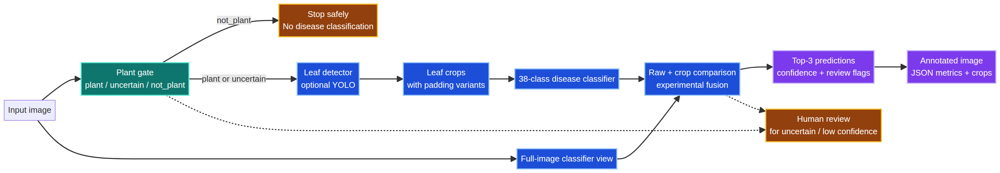
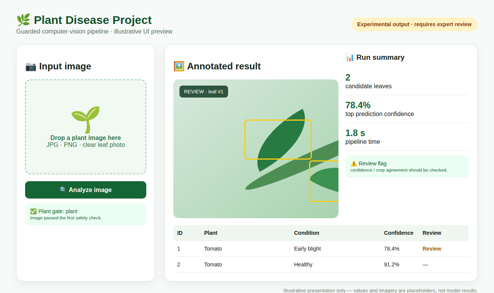

# Plant Disease Project 🌿

[](https://github.com/abdulwahabamernew-art/Plant_Disease_Project/actions/workflows/ci.yml)
[](LICENSE)
[](https://www.python.org/)
[](#how-it-works)

<p align="center">
  
</p>

> **A guarded computer-vision pipeline for plant-disease classification:** reject obvious non-plant inputs first, detect candidate leaves when configured, classify each crop across 38 disease classes, and export reviewable visual and JSON evidence.

## لماذا هذا المشروع؟ 🌱

المشكلة التي يعالجها المشروع ليست فقط اختيار اسم مرض من صورة. قبل التصنيف، يجب أولاً التأكد من أن الصورة تحتوي على نبات، ثم تحديد مناطق الأوراق المحتملة، ثم عرض النتيجة مع مستوى الثقة وعلامات المراجعة. لذلك يفصل المشروع بين **بوابة النبات** و**كاشف الأوراق** و**مصنف المرض** بدلاً من تمرير كل صورة مباشرة إلى مصنف الأمراض.

المشروع مصمم ليكون **source-only وoffline-friendly**: الكود والاختبارات والتوثيق عامة، بينما البيانات الخاصة والأوزان وملفات التشغيل الحساسة تبقى خارج المستودع.

## ما الذي يقدمه؟ ✨

- **Plant gate:** ثلاث حالات واضحة للصورة: `plant` أو `uncertain` أو `not_plant`.
- **Safe rejection:** إذا رفضت البوابة الصورة، يتوقف التصنيف المرضي ولا يتم اختلاق تشخيص.
- **Leaf detection:** دعم كاشف أوراق اختياري مبني على YOLO قبل تصنيف كل ورقة محتملة.
- **38-class classifier:** تصنيف حالات وأمراض PlantVillage باستخدام backend متوافق مع Keras.
- **Evidence-first outputs:** صورة annotated، وقصاصات الأوراق، وملف JSON يحفظ الإعدادات والنتائج والزمن وعلامات المراجعة.
- **Review-aware presentation:** تمييز الحالات منخفضة الثقة أو المتعارضة أو غير المؤكدة بدلاً من عرضها كحقيقة نهائية.
- **Security by default:** منع رفع الأوزان والبيانات والمفاتيح وملفات Android الحساسة إلى Git.

## كيف يعمل؟ 🔬

<p align="center">
  
</p>

1. **Input:** تحميل صورة RGB والتحقق من إمكان قراءتها.
2. **Plant gate:** حساب احتمال وجود نبات. تحت `0.40` تُرفض الصورة، ومن `0.40` إلى أقل من `0.80` تُعلّم كـ `uncertain`، وعند `0.80` أو أكثر تمر إلى المرحلة التالية.
3. **Leaf detector:** البحث عن مناطق أوراق مرشحة عند توفر نموذج الكاشف.
4. **Views:** إنشاء صورة كاملة وقصاصات مع padding قابل للضبط.
5. **Classification:** حساب `Top-3` لكل ورقة محتملة، مع مقارنة crop بالصورة الكاملة وfusion تجريبي قابل للمراجعة.
6. **Presentation:** إخراج ملخص عربي، جدول للنتائج، معرض للقصاصات، وصورة annotated.
7. **Audit trail:** حفظ metrics بصيغة JSON مع زمن كل مرحلة، إعدادات النماذج، مسارات المخرجات، وreview flags.

## واجهة النتائج المقترحة 🖥️

الواجهة لا تعرض رقماً واحداً فقط. العرض المقترح لكل تشغيل يتكون من أربع مناطق:

<p align="center">
  
</p>

> **تنبيه:** الصورة أعلاه Mockup توضيحي لتصميم الواجهة. القيم والصورة داخلهما أمثلة بصرية وليستا نتائج حقيقية؛ النتائج الفعلية تأتي من تشغيل النماذج محلياً.

### 1. حالة التحليل

تظهر رسالة واضحة حسب حالة البوابة:

- **تم الرفض:** الصورة لم تُعرّف كنبات، ولذلك لم يُشغّل مصنف الأمراض.
- **تحتاج مراجعة:** البوابة غير متأكدة، وكل التوقعات التالية تجريبية.
- **اكتمل التحليل التجريبي:** توجد أوراق محتملة، لكن النتيجة تحتاج تحققاً مرجعياً.

### 2. الصورة المشروحة

المربعات الخضراء تمثل توقعات عادية، والمربعات الصفراء تمثل حالة تحتاج مراجعة. كل مربع يحمل رقم الورقة والاسم المتوقع والثقة، مع شريط علوي يوضح أن النتيجة **experimental** وليست تشخيصاً زراعياً مؤكداً.

### 3. جدول المراجعة

يعرض الجدول رقم الورقة، نوع النبات، الحالة المتوقعة، الثقة، وأسباب المراجعة مثل `low_confidence` أو `raw_crop_disagreement` أو `small_object_candidate`.

### 4. الأدلة القابلة للتنزيل

لكل تشغيل يمكن حفظ الصورة المشروحة، قصاصات الأوراق، وملف JSON. هذا يجعل النتيجة قابلة للفحص وإعادة التحليل بدلاً من الاكتفاء بنص داخل الواجهة.

## النتائج الحالية 📊

النتائج الموجودة في المصدر الأصلي للمشروع هي نتائج خاصة بتقسيم اختبار **PlantVillage** وليست ضماناً لأداء كاميرا الهاتف في العالم الحقيقي:

| Model | PlantVillage test accuracy | التفسير |
|---|---:|---|
| Simple CNN | 29.29% | baseline تعليمي بسيط |
| MobileNetV2 transfer learning | **86.17%** | أفضل نتيجة مسجلة في تجربة PlantVillage الحالية |

استخدم الأرقام للمقارنة داخل التجربة نفسها فقط. لا تعرضها كدقة ميدانية، ولا تخلط بينها وبين أداء `plant gate` أو كاشف الأوراق. كما أن تغطية PlantDoc المتاحة جزئية، لذلك يلزم اختبار خارجي على صور هاتفية قبل أي استخدام عملي.

## ما الذي يخرج من التشغيل؟ 📦

```text
detection_v2/outputs/
├── annotated/       # الصورة الأصلية مع المربعات والملصقات
├── crops/           # قصاصات الأوراق المحتملة
├── metrics/         # JSON كامل للإعدادات والنتائج والأزمنة
├── failed/          # مدخلات مرفوضة أو بلا كشف مفيد
└── low_confidence/  # حالات تحتاج مراجعة إضافية
```

ملف JSON يحفظ، من بين حقول أخرى، `plant_gate` و`detected_leaves` و`top3` و`timing` و`review_flags`. الثقة هي ثقة النموذج في توقعه، وليست احتمالاً معايراً لصحة التشخيص.

## التشغيل المحلي ⚙️

المستودع لا يحتوي الأوزان أو البيانات الخاصة، لذلك لا يكون التشغيل كاملاً قبل توفير runtime artifacts بالطريقة الآمنة الموضحة في [`detection_v2/config/README.md`](detection_v2/config/README.md).

```bash
git clone https://github.com/abdulwahabamernew-art/Plant_Disease_Project.git
cd Plant_Disease_Project
python -m venv .venv
source .venv/bin/activate          # Windows: .venv\\Scripts\\activate
python -m pip install -r detection_v2/requirements.txt
# لتشغيل واجهة Gradio عند توفر إعدادات الواجهة:
python -m pip install -r detection_v2/requirements-ui.txt
```

بعد وضع الملفات الخاصة في المسارات المتوقعة داخل `config.py`، شغّل الاختبارات:

```bash
pytest detection_v2/tests
```

لإعادة بناء التجربة الكاملة، اتبع الترتيب الموجود في [`detection_v2/README.md`](detection_v2/README.md). استخدم المرحلة `09_Enhanced_Gradio_Interface.ipynb` كواجهة نهائية، وتجنب الواجهة القديمة في المرحلة 06 لأنها تتجاوز بوابة `plant/not-plant`.

## بنية المشروع 🗂️

```text
.
├── detection_v2/
│   ├── src/                  # pipeline, classifier, detector, presenter, visualization
│   ├── tests/                # core, image, output, UI and diagnostic tests
│   ├── config/               # local runtime guidance
│   └── requirements*.txt     # dependency variants
├── docs/
│   ├── assets/plant-disease-pipeline.png
│   └── plant-disease-pipeline.mmd
├── .github/workflows/        # CI checks
├── SECURITY.md
├── CITATION.cff
└── README.md
```

## قيود الاستخدام المسؤول ⚠️

هذا مشروع بحثي وتعليمي. قد يفشل النموذج مع الإضاءة المختلفة، الخلفيات المعقدة، الأمراض غير الموجودة في الفئات المدربة، أو الصور التي تختلف عن توزيع التدريب. لا تستخدم التوقع كبديل عن خبير زراعي، ولا تعرض حالة منخفضة الثقة كتشخيص مؤكد. يجب فحص تراخيص PlantVillage وPlantDoc والأوزان وأي صور خارجية قبل إعادة التوزيع.

## الأمن والخصوصية 🔒

لا ترفع API keys أو كلمات المرور أو datasets خاصة أو صور مستخدمين أو model weights غير المراجعة. راجع `git diff --cached` قبل كل push، واستخدم `.env.example` كقالب فارغ فقط.

## خارطة العروض المرئية 🎬

لإنشاء Demo حقيقي دون اختلاق نتائج، سجّل مقطعاً من 5 إلى 10 ثوانٍ بعد توفير الأوزان محلياً:

1. ارفع صورة ورقة.
2. أظهر انتقالها عبر `plant gate`.
3. أظهر المربع حول الورقة ونتيجة `Top-3`.
4. أظهر الصورة المشروحة والقصاصة وملف JSON.
5. أضف عنواناً واضحاً: `Experimental output — requires expert review`.

ضع الملفات المستقبلية في `docs/assets/` بالأسماء المقترحة `plant-disease-demo.gif` و`plant-disease-output.png`. لا تستخدم لقطة شاشة أو metric غير ناتجة من تشغيل فعلي.

## الترخيص والاقتباس

الكود متاح تحت [MIT License](LICENSE). قد تكون النماذج والأوزان والبيانات والأصول الخارجية خاضعة لتراخيص منفصلة. راجع [`CITATION.cff`](CITATION.cff) عند الاقتباس الأكاديمي.
